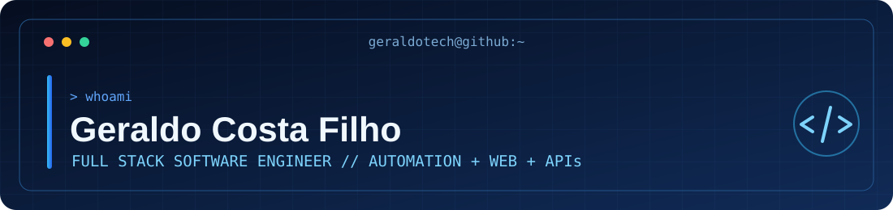
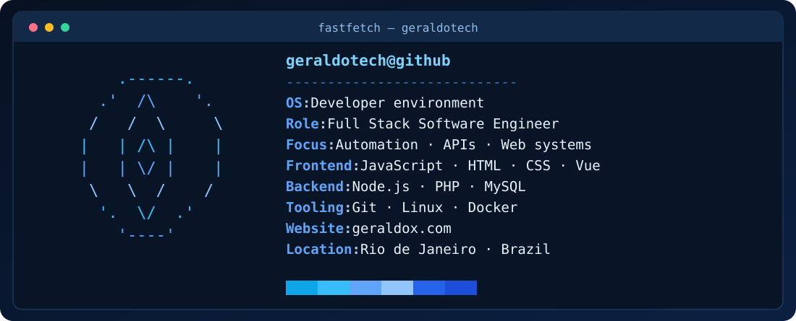

 

 

### About me

Full Stack Software Engineer building **automation tools**, **web applications** and **backend integrations**. I enjoy turning complex workflows into simple, maintainable solutions.

### Tech stack

`JavaScript` · `Vue` · `Node.js` · `PHP` · `MySQL` · `HTML` · `CSS` · `Git` · `Linux` · `Docker`

---

Designed with SVG · Fastfetch-inspired · Blue edition

